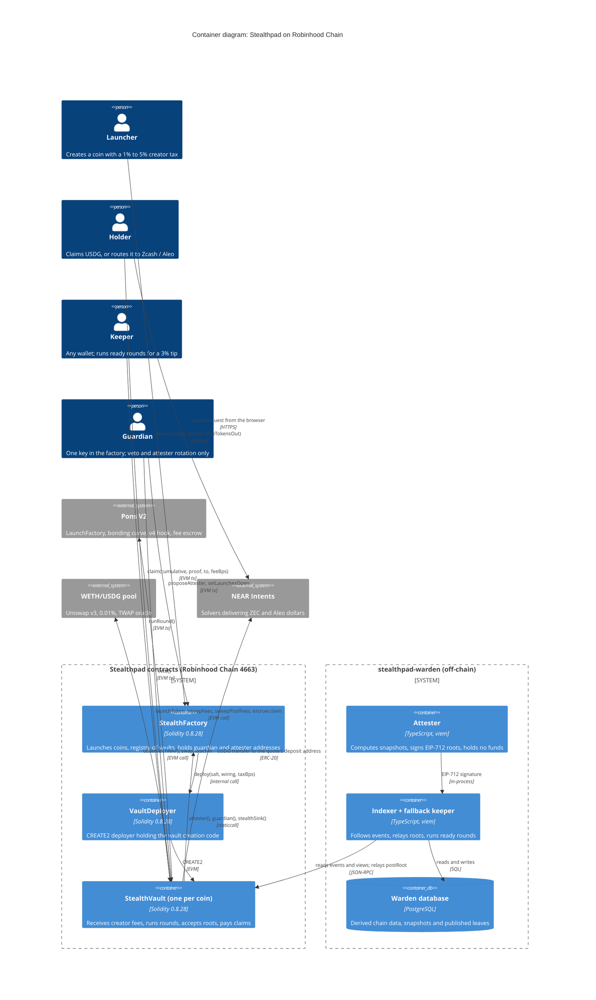
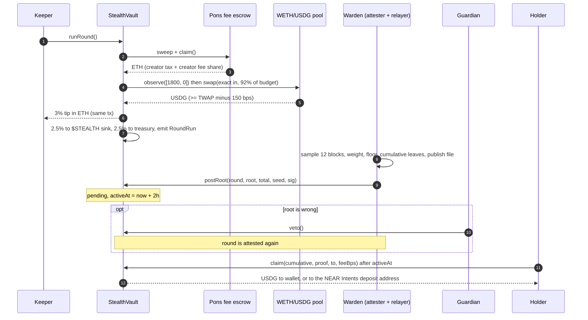
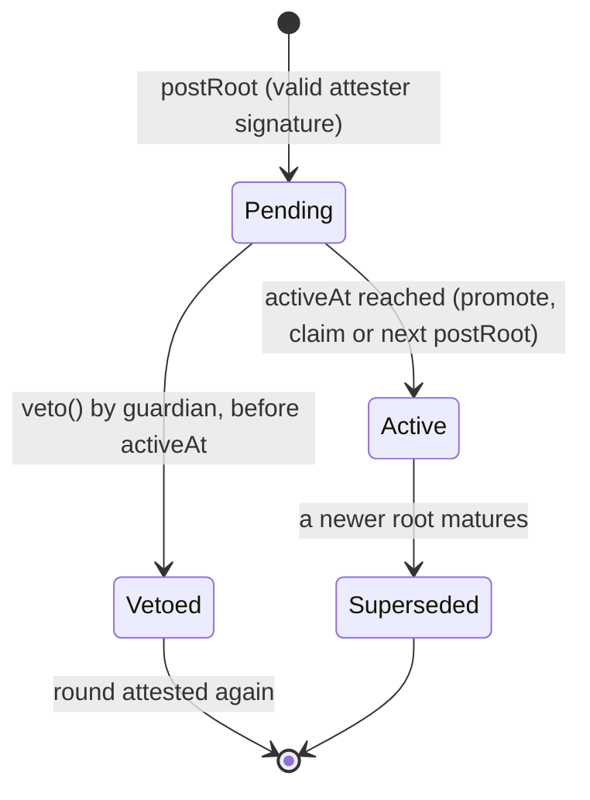

# Stealthpad Protocol Specification (C4, container level)

| Field | Value |
|---|---|
| Scope | The on-chain Stealthpad system on Robinhood Chain and every container it trusts or calls |
| Code | `src/` of this repository, Solidity 0.8.28 |
| Version | 0.1.0, pre-mainnet, not audited |
| Chain | Robinhood Chain, chainId 4663 (Arbitrum Orbit, ETH gas) |

This document describes Stealthpad at the C4 **container** level: what runs where, who holds which
key, and the exact message each container sends to another. It is written against the code, not
against intentions. Where a behaviour is planned rather than built, it says so.

---

## 1. System context

Stealthpad has one invariant that shapes every container boundary:

> **Money moves only on-chain, and only along paths fixed in bytecode. Off-chain containers read and
> sign. None of them can move a vault's funds.**

Four kinds of actor touch the system:

| Actor | Holds | Can | Cannot |
|---|---|---|---|
| Launcher | own wallet | launch a coin, pick the creator tax once, make a first buy | receive a launcher cut (there is none), change the tax later |
| Holder | own wallet | claim a cumulative share to a wallet or a route deposit address | claim more than the active root assigns |
| Keeper | any wallet with gas | run a ready round, earn 3% of it in the same transaction | choose where the other 97% goes |
| Guardian | one address in the factory | veto a pending root, rotate the attester (2-day delay), close new launches, hand the role over in two steps | move funds, post a root, change a split or tax, pause a round or a claim |

---

## 2. Container diagram

---

## 3. Containers

### 3.1 StealthFactory

- **Type**: smart contract, one instance per deployment
- **Technology**: Solidity 0.8.28, Foundry
- **Deployment**: `script/Deploy.s.sol:DeployFactory`, a single broadcast. Its constructor deploys the
  `VaultDeployer`.
- **Purpose**: the only way to create a Stealthpad coin. It fixes each vault's wiring (Pons V2
  factory, fee escrow, hook, WETH, USDG, pool, treasury), keeps the vault registry, and stores the
  two role addresses every vault reads: `guardian` and `attester`.

| Interface | Caller | Notes |
|---|---|---|
| `launch(LaunchInput, uint16 taxBps, uint256 minTokensOut) payable` | anyone | `taxBps` in {100, 200, 300, 400, 500}; reverts `LaunchesClosed` if the guardian closed launches |
| `predict(launcher, salt, taxBps) view` | anyone | CREATE2 address shown to the launcher before signing |
| `setStealthVault(vault)` | guardian, once | must be a vault this factory created |
| `proposeAttester` / `acceptAttester` / `cancelAttester` | guardian / anyone after 2 days / guardian | `ATTESTER_DELAY = 2 days` |
| `proposeGuardian` / `acceptGuardian` | guardian / pending guardian | two steps, no delay |
| `setLaunchesOpen(bool)` | guardian | affects new launches only |

### 3.2 VaultDeployer

- **Type**: smart contract, deployed by the factory's constructor
- **Purpose**: holds the `StealthVault` creation code so the factory's runtime stays under the
  contract size limit. Only its factory may call `deploy`. Vault address =
  `CREATE2(deployer, keccak256(abi.encode(launcher, salt)), keccak256(creationCode ++ abi.encode(wiring, taxBps, factory)))`.

### 3.3 StealthVault

- **Type**: smart contract, one per coin, deployed and launched in the same transaction
- **Purpose**: the coin's Pons V2 deployer **and** creator fee recipient from block one. It is the
  only container that ever holds user value.
- **Deliberately absent**: owner, `withdraw`, rescue, setters, upgrade path, `delegatecall`,
  `selfdestruct`.

| Interface | Caller | Pre-conditions | Effect |
|---|---|---|---|
| `runRound()` | anyone | launched; `lastRoundAt + COOLDOWN` passed; balance after sweep >= `MIN_ROUND` | caps budget, swaps holders' ETH to USDG with TWAP min-out, pays tip, $STEALTH share and treasury share |
| `postRoot(roundId, root, total, seed, sig)` | anyone | no pending root; `roundId` newer than active; `active.total <= total <= rounds[roundId].cumulativeHolders`; signature recovers to `factory.attester()` | stores a pending root with `activeAt = now + ROOT_DELAY` |
| `veto()` | `factory.guardian()` | a root is pending and not yet mature | deletes the pending root |
| `claim(cumulative, proof, to, feeBps)` | holder | proof of `(msg.sender, cumulative)` in the active root; `cumulative > claimed`; `feeBps <= 20`; `to` not zero and not the vault | pays `cumulative - claimed` minus fee to `to`, fee to treasury |
| `sweepAndClaim()` | anyone | launched | best-effort sweep, then `escrow.claim()` |

### 3.4 Pons V2 (external system)

- **Contracts**: LaunchFactory `0x7eD598BcEf8bd9Edd8C97A195C6d13f40801EC7e`, fee escrow, v4 hook, bonding curves
- **What Stealthpad relies on**: the vault is recorded as `creatorFeeRecipient`; creator tax on both
  legs and the creator share (70% today) of the 1% trading fee are credited to the escrow for the vault.
- **Launch terms (Pons settings)**: 0.0005 ETH launch fee, 99% tax during the first 3 seconds,
  graduation at 4.2 ETH. Stealthpad adds no launch fee.
- **Known external power**: the Pons V2 owner can queue a change of a coin's creator fee recipient
  behind a 3-day timelock. Funds already in a vault are out of its reach. The vault exposes
  `pendingOverride()` and `feeRouteIntact()` so anyone can check. A public watcher that alerts on
  every queued change is **planned** in `stealthpad-warden`; today the check is manual
  (`script/Deploy.s.sol:Inspect`).

### 3.5 WETH/USDG pool (external system)

- **Contract**: Uniswap v3, 0.01% fee tier, WETH is token0
- **Used for**: `observe([1800, 0])` to get the 30-minute mean tick, and an exact-input swap of the
  holders' ETH. The callback only accepts the pool, and only while the vault's swap flag is set.
- **Failure mode**: a pool without 30 minutes of observations reverts the round (`OLD`). Funds stay
  in the vault; the next round retries. A fill more than 1.5% below the TWAP reverts with
  `SwapOutTooLow`.

### 3.6 Attester (off-chain, `stealthpad-warden`)

- **Technology**: TypeScript, viem, `@openzeppelin/merkle-tree`, PostgreSQL
- **Holds**: one signing key, no funds. It never sends a transaction; the keeper wallet relays.
- **Algorithm** (`src/snapshot.ts` in the warden):

| Step | Rule |
|---|---|
| Seed | hash of the block the round ran in |
| Window | every block after the previous round's block, up to this round's block |
| Sample | 12 distinct blocks: `from + 1 + keccak256(seed, i) mod size`, the whole window if it is shorter |
| Weight | a holder's balance at the end of each sampled block, summed, i.e. the average over 12 |
| Floor | average >= 100,000 tokens (0.01% of supply); smaller balances roll into the next round |
| Exclusions | zero address, `0x…dEaD`, the token, the vault, the curve, the factory, the Pons V2 pool manager, hook and launch factory |
| Leaves | cumulative `(holder, total to date)` for every holder ever paid by this vault |
| Output | the published leaf file, its hash, and an EIP-712 signature over `PostRoot(roundId, root, total, seed)` |

### 3.7 Guardian

- **Type**: a key (a cold wallet today; a multisig in Phase 2)
- **Powers**: exactly those listed in section 1. Every power is exercised through a function whose
  code is in this repository and whose effect is visible as an event.
- **Residual risk**: the guardian cannot move funds, but it names the next attester. That is why
  `ATTESTER_DELAY` is 2 days and `AttesterProposed` is an event: a rotation nobody expected is public
  for 2 days before it can take effect. Moving the guardian to a multisig is a Phase 2 item.

### 3.8 NEAR Intents (external system)

- **Used for**: Zcash and Aleo payout routes. The holder's own browser requests a quote; the quote
  returns a deposit address on Robinhood Chain; the holder calls `claim` with `to` = that address.
- **Never on Stealthpad servers**: the destination address. The vault only sees the deposit address.
- **Delivery**: ZEC to a transparent `t1…` address (the route rejects shielded and unified
  addresses; the holder shields it in their own wallet after it lands), or USDCx / USAD to an Aleo
  address. An expired, unfilled quote is refunded in USDG to the holder's wallet by NEAR Intents.

---

## 4. Dynamic view: one round, one root, one claim

### Root lifecycle

Only one root is pending at a time. A root is never re-opened after a veto; a new signature is
required. Because leaves are cumulative, a newer active root replaces the older one without loss.

---

## 5. Inter-container protocols

| From | To | Protocol | Payload | Auth |
|---|---|---|---|---|
| Launcher | StealthFactory | EVM transaction | `LaunchInput`, `taxBps`, `minTokensOut`, ETH = launch fee + first buy | none (open) |
| StealthFactory | VaultDeployer | internal call | salt, `Wiring`, `taxBps` | `msg.sender == factory` |
| StealthVault | Pons V2 | external call | `TokenParams` with `creatorFeeRecipient = vault`, `buybackEnabled = false` | vault is the coin's deployer |
| StealthVault | Pons fee escrow | external call | `claim()` | escrow pays `msg.sender` |
| StealthVault | WETH/USDG pool | external call + callback | `observe`, `swap`, `uniswapV3SwapCallback` | callback: `msg.sender == pool && _inSwap` |
| StealthVault | StealthFactory | staticcall | `attester()`, `guardian()`, `stealthSink()` | read only |
| Warden | StealthVault | JSON-RPC, EVM transaction | `postRoot(roundId, root, total, seed, signature)` | EIP-712 domain `("Stealthpad", "1", 4663, vault)`, signer must equal `factory.attester()`, low-s only |
| Warden | Public | file | leaf file: vault, round, window, seed, samples, floor, distributable, carry, root, total, leaves | anyone recomputes with `pnpm verify` |
| Holder browser | NEAR Intents | HTTPS | destination address, amount | quote bound to the holder's session |
| Holder | StealthVault | EVM transaction | `cumulative`, `proof`, `to`, `feeBps` | Merkle proof of `(msg.sender, cumulative)` |

---

## 6. Trust boundaries and failure modes

| Container fails | Effect on funds | Effect on users | Recovery |
|---|---|---|---|
| Attester silent | none, USDG stays in the vault | new claims wait; rounds still run | restart warden; Phase 2 backup attester set |
| Attester key compromised | a bad root could misassign **unclaimed** USDG only after 2 hours | guardian must veto each bad root in the window | guardian `proposeAttester`, 2-day delay, `acceptAttester` |
| Guardian key lost | none | bad roots cannot be vetoed; attester cannot rotate | pre-arranged `proposeGuardian`; Phase 2 multisig |
| Guardian key compromised | none directly; indirectly, it can propose its own attester, which takes effect 2 days later and could then post roots nobody vetoes | valid roots can be vetoed repeatedly, delaying claims; launches can be closed | watch `AttesterProposed`; the legitimate key holder calls `cancelAttester` and `proposeGuardian`; holders have 2 days plus `ROOT_DELAY` to claim under the current root |
| Pons owner queues a fee-recipient override | future inflow could be redirected after 3 days; vault balance untouched | visible via `pendingOverride()` | public alert (planned watcher), communicate to holders |
| Pool oracle too short or fill too poor | none | round reverts | next keeper retries |
| Treasury or $STEALTH sink refuses ETH | none | round still completes; refused share falls back or stays as next budget | none needed |
| Warden database lost | none | API data missing until re-indexed | restore dump, or re-index from the factory's deploy block |

### Invariant covered by fuzzing

`usdg.balanceOf(vault) >= vault.unclaimed()` after every round and every claim, across 512 fuzz runs
with random tax amounts, splits between holders and round counts
(`test/StealthVault.t.sol::testFuzz_vault_always_covers_unclaimed`).

---

## 7. Infrastructure

| Container | Runs on | Scaling | Resources |
|---|---|---|---|
| StealthFactory, VaultDeployer, StealthVault | Robinhood Chain | one vault per coin; no shared state between vaults beyond the factory's read-only role addresses | gas only |
| Warden (indexer, attester, keeper) | a VPS, non-root container, read-only root filesystem | a single writer per database; independent keepers scale horizontally by design | small: one Node process and PostgreSQL |
| Warden database | managed PostgreSQL or a private-network container | vertical | grows with transfers of all coins |
| Read API and app | `stealthpad-conduit`, `stealthpad-console` | stateless, horizontal | read-only database role |

Deployment configuration: `script/Deploy.s.sol` (contracts), `docker-compose.yml` and `Dockerfile`
in `stealthpad-warden` (worker).

---

Pre-mainnet specification. Not audited. No contract address exists yet; the $STEALTH address
will be published on launch day, from official channels only.
